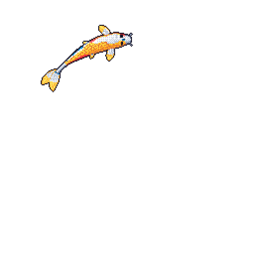

  

### About Me

I'm a web developer from **Jhapa, Nepal**. I'm **16 years old** and have been building websites for over **three years**.

I have a strong foundation in **frontend development** and am currently learning **backend development**.

---

### 🌱 What I'm up to

- 🌐 Building and improving full-stack web projects
- ⚛️ Getting better with React
- 🛠️ Learning to build APIs with Node.js and Express
- 🗄️ Exploring MongoDB and Mongoose

### 🧰 Tech Stack

  
  
  
  
  
  
  
  

### 🐟 A little koi in my Git pond

  

   
  🌐 **Portfolio:** Coming soon — check back to learn more about my work.

